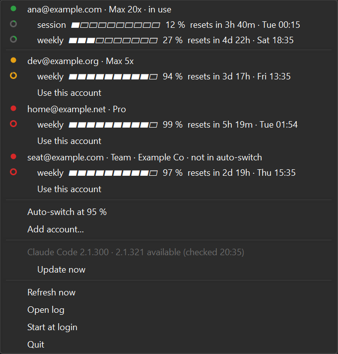

# ccswitch

Keep several Claude Code logins on one machine. See how much of each account's limits is used, get a
notification before a limit runs out, switch accounts in one click (or let it switch by itself), and see or
update the installed Claude Code version.

One tray icon, a `ccswitch` CLI, and an optional Claude Code status line, all reading the same state.



| Platform | State |
|---|---|
| Windows 10 / 11 | Used daily. |
| macOS | Builds in CI, **never run on a Mac** (see [Known limits](#known-limits)). |
| Linux | Builds and tests in CI; the tray needs AppIndicator / StatusNotifier support. |

## Before you start

- Claude Code installed, `claude` on your `PATH`, and logged in with a subscription account
  (`claude auth status` shows it). API keys and claude.ai web/desktop logins are out of scope.
- **Check the rules first.** Using several subscriptions to get past one account's limits may not fit
  Anthropic's terms or your company's policy. Deciding that is up to you. A seat in a Team or Enterprise
  organisation starts out of the auto-switch pool; any other account starts in it. Change either with
  `ccswitch pool <email> on|off`.

## Install

**From a release:** download `ccswitch-<version>-windows.zip` (or `-macos` / `-linux`) from the repository's
Releases page and unzip it into a folder of your own, e.g. `%LOCALAPPDATA%\Programs\ccswitch`. It contains
`ccswitch` (the CLI) and `ccswitch-app` (the tray). The binaries are not signed: Windows SmartScreen may say
"Windows protected your PC" → **More info** → **Run anyway**.

**From source:** Go 1.26 and [Task](https://taskfile.dev).

    git clone https://github.com/diegofal/ccswitch && cd ccswitch
    task build            # → bin/ccswitch(.exe) and bin/ccswitch-app(.exe)

On Linux the tray also needs `libgtk-4-dev libwebkitgtk-6.0-dev`; on macOS, the Xcode command line tools.

Put the folder on your `PATH` if you want to type `ccswitch` anywhere (the examples below assume you did).

## First run

1. **Capture the account you're logged in with.** Nothing in Claude Code is changed.

       ccswitch check

   You see your email, plan, each active limit with a bar, and the Claude Code version.

2. **Add each other account.** A browser login opens; log in with the other account. It runs in a scratch
   folder, so your current login stays as it is. Repeat for every account.

       ccswitch add

3. **Start the tray** (`ccswitch-app`), open its menu and tick **Start at login**.

4. Optional: **auto-switch.** Tick **Auto-switch at 95 %** in the menu (or `ccswitch auto on`). When the
   active account reaches 95 % of any limit, ccswitch switches to the in-pool account with the most room
   left, sends a notification, and offers **Undo** for 10 minutes. Keep an account out of it with
   `ccswitch pool <email> off`.

5. Optional: **status line.** In `~/.claude/settings.json` (use the full path to the binary if it is not on
   your `PATH`):

   ```json
   { "statusLine": { "type": "command", "command": "ccswitch statusline" } }
   ```

   Claude Code then shows `<account> · weekly 9% · Claude Code 2.1.300 (2.1.319 available)` at the bottom.
   It reads the saved state only, with no network call.

## Reading the tray

- **The icon** is a ring filled to the active account's highest limit: green under 80 %, amber from 80 %,
  red from 95 %. Grey means the last read is old; red with a dot means the read failed.
- **The menu** shows the account in use first. The others follow, the soonest usable first: accounts under
  the auto-switch threshold (lowest use first), then the ones over it by when they reset. Each account has a
  coloured dot with the same colours as the icon; each limit shows its percent and when it resets, e.g.
  `resets in 1d 5h · Tue 01:00`.
- **Use this account** makes it the live login. **Refresh now** reads every account again. **Open log**
  opens the log.
- When a newer Claude Code is on npm, the version row says so and offers **Update now** (`claude update`).

Notifications: at 80 % and 95 % of each limit (once per reset window), when a limit is reached, when it is
available again, on every automatic switch, and when an account's usage stops being readable.

## CLI

    ccswitch status              accounts, limits and versions as last read
    ccswitch check               read every account's usage now, then show the status
    ccswitch use <email>         make that account the live login
    ccswitch undo                switch back after the last switch, while that is offered
    ccswitch add                 log in another account (opens the browser)
    ccswitch remove <email>      forget an account (not the active one)
    ccswitch pool <email> on|off let auto-switch use the account, or not
    ccswitch auto on|off         switch by itself when the active account reaches the threshold
    ccswitch update              install the latest Claude Code
    ccswitch watch [--once]      poll until Ctrl-C (for a machine without the tray)
    ccswitch statusline          one line for Claude Code's status line

`<email>` may be any unique beginning of the address: `ccswitch use ana`.

## What a switch does

It swaps the login in your one `~/.claude`: only the `claudeAiOauth` and `organizationUuid` members of
`.credentials.json` and `oauthAccount` in `~/.claude.json`. Everything else stays: MCP logins (Linear,
Slack, …), history, settings, projects. The previous login is saved first; a failed switch restores it by
itself.

**New `claude` sessions use the new account.** Whether a session that is already open follows the switch
has not been checked yet (PLAN V3). To be sure, start a new session or `claude --continue`.

## Your data

| | Windows | macOS | Linux |
|---|---|---|---|
| Folder | `%APPDATA%\ccswitch` | `~/Library/Application Support/ccswitch` | `~/.local/share/ccswitch` |
| Account tokens | `accounts.json`, encrypted with DPAPI (your Windows user only) | Keychain item `ccswitch-accounts` | `accounts.json`, mode 0600 |

The folder also holds `state.json` (last usage read), `settings.json` and `ccswitch.log`. No token is ever
logged or printed. Tokens never leave the machine except to Anthropic: ccswitch calls `api.anthropic.com`
(usage) and `console.anthropic.com` (token refresh for inactive accounts, when their access token has
expired or a week before their refresh token would), and `registry.npmjs.org` for the latest Claude Code version. Nothing else.

## Troubleshooting

- `ccswitch status` shows `Last error: …`; the full story is in `ccswitch.log` (tray: **Open log**).
- **"unreadable: …" on an account:** its stored login no longer works (for example it was logged out
  elsewhere). Remove it and add it again: `ccswitch remove <email>` then `ccswitch add`.
- **Claude Code says you are logged out:** `claude auth login`, then `ccswitch check`. The new login is
  captured and the stored copy updated.
- **No tray icon on Linux (GNOME):** install the AppIndicator extension.

## Uninstall

Untick **Start at login**, **Quit** the tray, delete the program folder and the data folder above (on macOS
also the Keychain item `ccswitch-accounts`). Claude Code keeps whichever account was active last.

## Known limits

- **macOS has never run it.** The Keychain code is tested against a fake `security` only. Not yet checked on a
  real Mac: the Keychain item names Claude Code uses, whether ccswitch's writes stay readable by Claude Code,
  the menu bar icon, notifications from an unsigned app, and Gatekeeper on a downloaded zip (PLAN V5).
- A session already open may keep the account it started with (PLAN V3, see above).
- The usage endpoint is Claude Code's own and undocumented. If its shape changes, accounts show "unreadable"
  rather than a wrong number.

## How it is built

Go 1.26 + Wails v3, one core and three front ends that hold no logic. Two programs share that core
(`internal/wiring`): `ccswitch`, a console program for the CLI and status line, and `ccswitch-app`, the tray,
built windowed on Windows so it opens no console at login. Design, facts and decisions:
[PLAN.md](PLAN.md). Rules for contributors (and for Claude Code working on it): [CLAUDE.md](CLAUDE.md).
The real-login checklist: [TRY-IT.md](TRY-IT.md). `go run -ldflags "-H windowsgui" scripts/traydemo.go` runs
the real tray on made-up accounts (no login, no network), for screenshots and UI work. `task ci` runs what CI runs (format, vet, lint, tests with
coverage gates, architecture test, build) on Windows, macOS and Ubuntu; a `v*` tag publishes one zip per OS.
